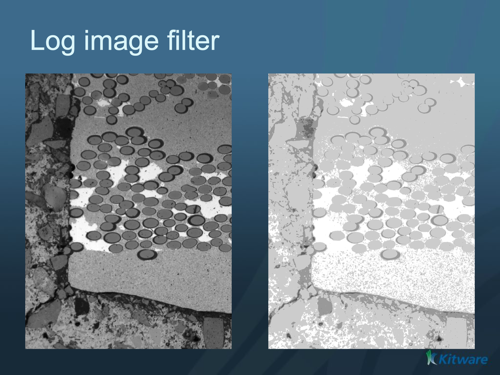

# Log Image Filter

## Group (Subgroup)

ImageProcessing (Pointwise)

## Description

Computes the natural logarithm, `ln(x)`, of each image value. The base is the mathematical constant *e*, approximately 2.71828. The filter applies the same operation to each component and preserves the array's tuple and component shapes.

Use positive input values to obtain finite results. The logarithm is dimensionless. If the source has physical units, first divide by a suitable reference with the same units. This transform does not supply a physical calibration.

### Output Type and Precision

Preflight and execution use the following output types:

| Input type | Output type |
|---|---|
| int8, uint8, int16, uint16, int32, uint32, int64, uint64 | float64 |
| float32 | float32 |
| float64 | float64 |

The calculation uses float64 precision. Integer input produces float64 output so that fractional logarithms are retained. For example, `ln(1) = 0` and `ln(2)` is approximately 0.6931471805599453. Float32 input retains float32 output and its usual rounding.

Converting an int64 or uint64 input to float64 can round the input before the logarithm is calculated. Nearby large integers can therefore produce the same result. Float64 output avoids an additional rounding step to float32; it does not make every 64-bit integer exactly representable.

Each output value from integer input occupies 8 bytes. Compared with the former same-type output, this uses 8, 4, 2, or 1 times the storage for 8-, 16-, 32-, or 64-bit input, respectively. These factors describe array values and exclude storage metadata and compression.

### Zero, Negative, and Nonfinite Values

The filter retains ordinary floating-point behavior:

| Input value | Output value |
|---|---|
| Positive finite value | Finite natural logarithm |
| Positive or negative zero | Negative infinity |
| Negative finite value | NaN (not a number) |
| Negative infinity | NaN |
| Positive infinity | Positive infinity |
| NaN | NaN |

Zero and negative input are distinct cases. The filter does not clamp them to a positive value or replace the result with zero. Positive subnormal values, which are smaller than the smallest normal floating-point value, still have finite logarithms.

### Existing Pipelines

Integer input now produces float64 output. Earlier same-type integer output discarded fractional results; `ln(2)` became zero. Update downstream filters that require integer arrays. Recheck thresholds and zero/nonzero masks that depended on the old quantization.

Handle NaN and infinity explicitly before range calculations or conversion to integer. An unchecked conversion back to integer can reintroduce unsafe behavior.

## Algorithm

This is an ITK-free implementation of the legacy ITK Log Image Filter. It uses the existing pointwise traversal for resident and disk-backed arrays. Resident storage retains the direct route when available. The buffered route reads and writes bounded batches through the store interface. It does not create a full-array resident copy for this transform. Cancellation and storage failures follow the shared pointwise execution path.

% Auto generated parameter table will be inserted here

## Example Pipelines

## License & Copyright

Please see the description file distributed with this plugin.

## DREAM3D-NX Help

If you need help, need to file a bug report or want to request a new feature, please head over to the [DREAM3DNX-Issues](https://github.com/BlueQuartzSoftware/DREAM3DNX-Issues/discussions) GitHub site where the community of DREAM3D-NX users can help answer your questions.
