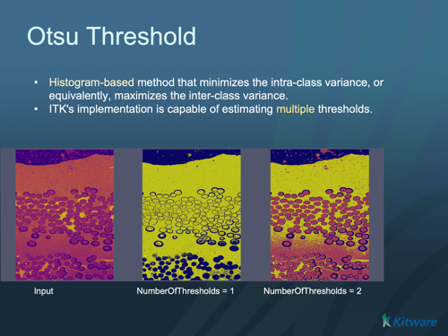

# Otsu Multiple Thresholds Image Filter

Threshold an image using multiple Otsu Thresholds.

## Group (Subgroup)

ImageProcessing (Thresholding)

## Description

This filter creates a labeled image that separates the input image into various classes. The filter computes the thresholds using a multi-Otsu calculator and applies those thresholds to the input image to produce class labels. The **Number Of Histogram Bins** and **Number Of Thresholds** control the calculator. The **Label Offset** is added to every output label so labels can start from a value other than zero.

Each finite, selected voxel receives the number of thresholds that its intensity strictly exceeds, plus **Label Offset**. A value equal to a threshold belongs to the lower class. The input can use any scalar signed or unsigned integer type, `float32`, or `float64`. The output is always a scalar `uint8` label image with the input tuple shape. Threshold values use the input intensity units; output labels have no intensity units.

The configured class interval is **Label Offset** through **Label Offset + Number Of Thresholds**, including both endpoints. The sum must not exceed 255. The filter rejects an invalid interval instead of wrapping labels. It does not renumber classes or widen the output type.

### NaN and infinity

**Nonfinite Input Handling** has two choices:

- **Error** is the default. A selected NaN, negative infinity, or positive infinity stops the filter. Choose a deliberate handling method before rerunning the pipeline.
- **Warn and Continue** retains these selected samples in the histogram. Only selected finite values set the histogram bounds. NaN and negative infinity contribute to the first bin and receive the ordinary lowest class label. Positive infinity contributes to the last bin and receives the ordinary highest class label. These samples affect threshold fitting; they are not treated as excluded pixels. The filter returns one warning with counts for the three nonfinite kinds. Classification can be unreliable or unpredictable.

Both choices require at least one selected finite sample. Empty data, an all-false mask, or data with no selected finite value cannot define a histogram range and cause an error. Warn does not silently remove nonfinite samples.

### Explicit mask and excluded labels

Enable **Use Mask Array** to select a **Mask Array**. The mask must be scalar `bool` or `uint8` and have the same tuple count as the input. Tuples are paired in flat order; the mask can have a different tuple shape or parent group. False/zero excludes a pixel; true or any nonzero `uint8` value selects it. The filter applies this selection before range, histogram, and nonfinite checks. An excluded NaN or infinity therefore causes no nonfinite error or warning.

Excluded pixels receive **Masked Label**, which defaults to 255. This label must lie outside the entire configured class interval, even if some configured classes have no pixels. With a mask, at most 255 ordinary classes and one distinct excluded label fit in `uint8`. An interval that uses all labels 0 through 255 cannot leave a distinct Masked Label. The filter reports a collision and requires a control change.

A distinct label does not make downstream filters ignore excluded pixels. Supply the mask or an explicit background/exclusion rule to consumers that must ignore them. Changing histogram participation can change phase fractions, feature counts, and connectivity.

For example, with input `[0, 0, 4, 4, NaN, -inf, +inf]`, two bins, one threshold, and Label Offset 7, Warn produces histogram counts `[4, 3]` and labels `[7, 7, 8, 8, 7, 7, 8]`. The finite bounds remain 0 and 4. An explicit mask `[1, 1, 1, 1, 0, 0, 0]` instead produces counts `[2, 2]`, no nonfinite warning, and labels `[7, 7, 8, 8, 255, 255, 255]` with Masked Label 255. This mask also permits Error mode because it excludes all nonfinite values.

### Precision and pipeline migration

Histogram bounds, bin measurements, and threshold fitting use `float64`. The filter checks for detectable unusable range/bin geometry, nonfinite arithmetic, and objective underflow. For example, distinct adjacent large 64-bit integers can become equal after conversion to `float64`, and very small nonzero class means can square to zero. These conditions cause a numeric error. Rescale the finite data or use fewer bins where suitable. The checks do not establish exact arbitrary-precision Otsu accuracy. True finite constants retain the lower-class tie behavior.

The finite tie tolerance, ordinary threshold search, and Valley Emphasis behavior are retained. **ReturnBinMidpoint** selects a bin midpoint instead of its maximum for the returned threshold. These checks add no automatic normalization or new scientific fitting rule.

Existing pipelines receive Error, Use Mask Array off, and Masked Label 255 as defaults. Finite pipelines with valid label intervals retain their labels. Pipelines that previously contained NaN/infinity now stop by default. Choose Warn to keep the stated endpoint-bin participation, or supply an explicit mask to exclude samples. Replacing nonfinite values upstream adds replacement intensities to the histogram and can bias thresholds; it is not statistical exclusion.

This filter also includes an option to use the valley emphasis algorithm from H.F. Ng, "Automatic thresholding for defect detection", Pattern Recognition Letters, (27): 1644-1649, 2006. The valley emphasis algorithm is particularly effective when the object to be thresholded is small. It is turned off by default; enable it with **Valley Emphasis**.

ITK-free, out-of-core-capable reimplementation of the legacy ITK Otsu Multiple Thresholds Image Filter. The histogram and input range are computed with bounded-memory streaming passes, so memory use stays bounded regardless of image size.

## Algorithm

For integral inputs whose selected native intensity span is at most 65,535, the filter can determine the input range and exact value frequencies in one scan using a fixed 65,536-entry frequency ring. It then fills the requested histogram without rereading the input. Wider integral ranges, or a working-memory grant that cannot hold this optional ring, use a second bounded histogram scan. Floating-point inputs use a selected finite range/count scan followed by the histogram scan. A true constant has an analytic tied-threshold path.

The histogram uses the existing marginal upper bound `max + (max - min) / (numberOfBins * 100)`. An upper-bound extension that rounds back to `max` is permitted when the bin geometry remains usable; endpoint clamping keeps minimum/maximum samples inside their bins before an integer index conversion. Native full-span 64-bit inputs remain valid for a two-bin split. No native maximum is incremented.

Thresholds are calculated from the histogram and applied independently to each selected voxel. Resident scans use direct spans. Other scans use serial bulk input/mask transfers with bounded owned buffers and working-memory reservations. Floating-point range scans reduce fixed blocks in parallel when multicore support is enabled and a batch contains more than one block. Workers read only resident spans or owned buffers. The main thread merges finite bounds and selected counts in block order. The summary table belongs to the current bounded batch and does not grow with the full image.

The input, mask, and floating-range summaries share a scratch target of at most 64 MiB; a low grant can reduce a buffered scan to one tuple. The masked output pass reserves combined input, mask, and label buffers. Boolean masks use contiguous owned storage. The optional ring and histogram/solver arrays depend on the fixed ring size and requested bin/class counts, not on image volume. The unmasked output pass retains the existing resident/buffered pointwise routes. No full-volume finite-only copy is made.

Cancellation is checked during scans and threshold search and before label writes. Transfer failures remain errors. Completed earlier label batches are not rolled back if a later output transfer fails.

% Auto generated parameter table will be inserted here

## Example Pipelines

## License & Copyright

Please see the description file distributed with this plugin.

## DREAM3D-NX Help

If you need help, need to file a bug report or want to request a new feature, please head over to the [DREAM3DNX-Issues](https://github.com/BlueQuartzSoftware/DREAM3DNX-Issues/discussions) GitHub site where the community of DREAM3D-NX users can help answer your questions.
