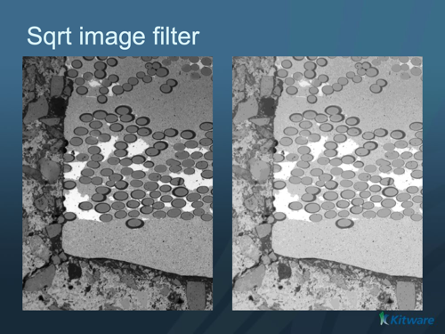

# Sqrt Image Filter

## Group (Subgroup)

ImageProcessing (Pointwise)

## Description

Computes the square root, `sqrt(x)`, of each image value. The filter applies the same operation to each component and preserves the array's tuple and component shapes.

Use finite nonnegative values to obtain finite results. The output has the square root of the input units. For example, input in squared length units produces output in length units. Dimensionless input produces dimensionless output. The transform alone does not supply a physical calibration.

### Output Type and Precision

Preflight and execution use the following output types:

| Input type | Output type |
|---|---|
| int8, uint8, int16, uint16, int32, uint32, int64, uint64 | float64 |
| float32 | float32 |
| float64 | float64 |

The calculation uses float64 precision. Integer input produces float64 output because a square root usually has a fractional part. For example, `sqrt(0) = 0`, `sqrt(4) = 2`, and `sqrt(2)` is approximately 1.4142135623730951. This is a mathematical square root, rather than an integer-root operation that discards the fractional part. Float32 input retains float32 output and its usual rounding.

Converting int64 or uint64 input to float64 can round the input before the square root is calculated. Nearby large integers can therefore produce the same result. Float64 output avoids an additional rounding step to float32; it does not make every 64-bit integer transform exact. For example, the float64 result for `sqrt(INT64_MAX)` is approximately 3037000499.97605. Its representation error is about 0.000000208, compared with about 52 for float32.

Each output value from integer input occupies 8 bytes. Compared with the former same-type output, this uses 8, 4, 2, or 1 times the storage for 8-, 16-, 32-, or 64-bit input, respectively. These factors describe array values and exclude storage metadata and compression.

### Zero, Negative, and Nonfinite Values

The filter retains ordinary floating-point behavior:

| Input value | Output value |
|---|---|
| Positive finite value | Positive finite square root |
| Positive zero | Positive zero |
| Negative floating zero | Negative zero |
| Negative finite value | NaN (not a number) |
| Negative infinity | NaN |
| Positive infinity | Positive infinity |
| NaN | NaN |

The filter does not clamp negative values to zero. Positive subnormal values, which are smaller than the smallest normal floating-point value, have positive square roots. Negative signed integer input produces a representable NaN in the float64 output.

### Existing Pipelines

Integer input now produces float64 output. Earlier same-type integer output discarded fractional results; `sqrt(2)` became 1. Update downstream filters that require integer arrays. Recheck thresholds that depended on integer quantization. For valid nonnegative input, the direct zero/nonzero status is preserved: zero stays zero, and positive input stays positive.

Handle NaN and infinity explicitly before range calculations or conversion to integer. An unchecked conversion back to integer can reintroduce unsafe behavior.

## Algorithm

This is an ITK-free implementation of the legacy ITK Sqrt Image Filter. It uses the existing pointwise traversal for resident and disk-backed arrays. Resident storage retains the direct route when available. The buffered route uses a default 64 MiB transfer-scratch target, with a minimum of one complete storage slab across the trailing tuple dimensions. For Z/Y/X tuple order, this can be an XY slice. A slab can exceed the target or cover the whole array. Bulk store reads and writes are serial; parallel calculations use owned buffers. Sqrt adds no separate full-volume scratch array. Cancellation and storage failures follow the shared pointwise execution path.

% Auto generated parameter table will be inserted here

## Example Pipelines

## License & Copyright

Please see the description file distributed with this plugin.

## DREAM3D-NX Help

If you need help, need to file a bug report or want to request a new feature, please head over to the [DREAM3DNX-Issues](https://github.com/BlueQuartzSoftware/DREAM3DNX-Issues/discussions) GitHub site where the community of DREAM3D-NX users can help answer your questions.
