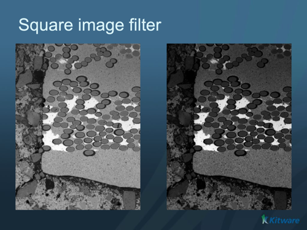

# Square Image Filter

## Group (Subgroup)

ImageProcessing (Pointwise)

## Description

Computes `x * x` for each value in the selected image cell array. The output keeps the input tuple and component shapes. Each component is squared separately. The output has the square of the input units; for example, an input in metres gives an output in square metres. Dimensionless input remains dimensionless.

### Output types and exact integer results

The filter widens 8-, 16- and 32-bit integers by one native width. It multiplies integers in the output integer type, without an intermediate floating-point conversion.

| Input type | Output type |
|---|---|
| int8 | int16 |
| uint8 | uint16 |
| int16 | int32 |
| uint16 | uint32 |
| int32 | int64 |
| uint32 | uint64 |
| int64 | int64 |
| uint64 | uint64 |
| float32 | float32 |
| float64 | float64 |

For example, *16* gives the exact integer result *256*, and *4097* gives *16785409*. The largest uint32 input, *4294967295*, gives the exact uint64 result *18446744065119617025*.

The 64-bit integer output types have these input limits:

- int64: *-3037000499* through *3037000499*, inclusive.
- uint64: *0* through *4294967295*, inclusive.

An input outside these limits produces an error before integer multiplication. The error identifies the input array, the offending value and the allowed bound. The filter checks the signed limits directly, including the int64 minimum value. It does not saturate the output or change an overflowing integer result to a floating-point type.

### Floating-point results

Floating-point inputs keep their type. Squaring either signed zero gives positive zero. NaN gives NaN, and either infinity gives positive infinity. A result above the output finite range gives positive infinity. Small results can become subnormal values or positive zero through underflow. Floating-point results have the precision of their output type; they are not exact integer substitutes.

### Input and downstream guidance

Select an image geometry and a numeric cell array that belongs to that geometry. The array must have one tuple per image cell. An image reader or an earlier image-processing filter can supply this array.

The widened 8-, 16- and 32-bit integer output uses twice the input array's storage. Check any later filter or export that requires a specific integer width. Exact integer comparisons can also differ from older results that lost low bits through floating-point arithmetic.

For larger 64-bit integer inputs, explicitly convert the input array to float64 before this filter if approximate squares are acceptable. The conversion and floating-point multiplication can lose integer units. Choose that conversion deliberately rather than narrowing the exact integer output to fit a downstream width.

## Algorithm

The filter uses the existing pointwise traversal for both in-memory and disk-backed arrays. In-memory arrays use the resident route when available. Other stores use serial bulk reads and writes, with arithmetic on owned resident buffers. The generic traversal targets a 64 MiB scratch budget but requires at least one storage slab; a slab can exceed that target or cover a thin array. Square adds no separate temporary buffer beyond the existing traversal and scan buffers.

Only int64 and uint64 inputs require an extra native-integer minimum/maximum scan before multiplication. This adds one complete input read for those types. The scan uses the existing resident or buffered reduction and checks cancellation and read errors. Other types use one pointwise pass. Cancellation and I/O failures follow the filter framework's existing result behavior. A later I/O failure does not guarantee that the output is unchanged.

% Auto generated parameter table will be inserted here

## Example Pipelines

## License & Copyright

Please see the description file distributed with this plugin.

## DREAM3D-NX Help

If you need help, need to file a bug report or want to request a new feature, please head over to the [DREAM3DNX-Issues](https://github.com/BlueQuartzSoftware/DREAM3DNX-Issues/discussions) GitHub site where the community of DREAM3D-NX users can help answer your questions.
