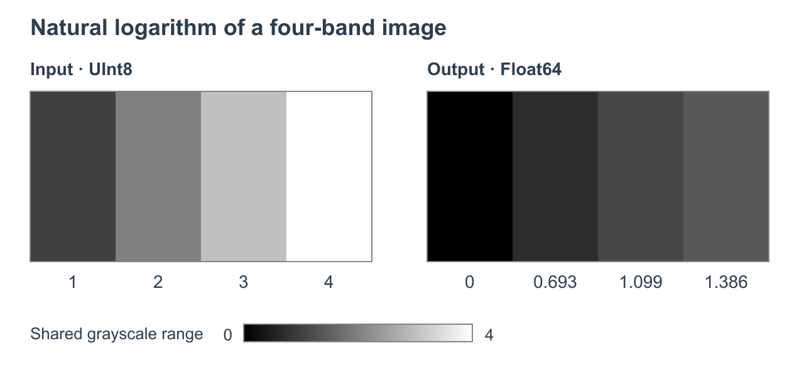

# Log Image Filter

Calculates the natural logarithm, ln(x), for every image value.

## Group (Subgroup)

NXImageProcessing (Pointwise)

## Description

Use the natural logarithm for positive dimensionless ratios, such as transmission normalized to a reference. An integer input of 2 gives approximately 0.6931471805599453. Values between 0 and 1 have negative logarithms.

Both panels use the same grayscale range from 0 to 4. The labels show the input values and the filter output rounded to three decimals.

### Input and output

| Input element type | Output element type |
|---|---|
| Any 8-, 16-, 32- or 64-bit signed or unsigned integer | Float64 |
| Float32 | Float32 |
| Float64 | Float64 |

The output keeps the input tuple and component dimensions. For an existing pipeline with integer input, review downstream thresholds and any filter that requires an integer array. The floating-point output can contain fractional values.

### Zero, range and nonfinite values

An input of 1 gives zero. Either sign of zero gives negative infinity, and a negative input, including negative infinity, gives NaN. Positive infinity gives positive infinity, and NaN gives NaN.

## Algorithm

The filter computes each component independently in Float64 and writes the selected output type. Converting a 64-bit integer to Float64 can round the input when its magnitude exceeds 2^53. Resident and disk-backed arrays use the same calculation.

% Auto generated parameter table will be inserted here

## Example Pipelines

The **Radiography Intensity Calibration** bookmark applies this transform to normalized transmission data. [Example pipeline guide](https://github.com/BlueQuartzSoftware/simplnx/blob/develop/src/Plugins/NXImageProcessing/pipelines/15_Radiography_Intensity_Calibration/15_Radiography_Intensity_Calibration.md)

## License & Copyright

Please see the description file distributed with this plugin.

## DREAM3D-NX Help

If you need help, need to file a bug report or want to request a new feature, please head over to the [DREAM3DNX-Issues](https://github.com/BlueQuartzSoftware/DREAM3DNX-Issues/discussions) GitHub site where the community of DREAM3D-NX users can help answer your questions.
