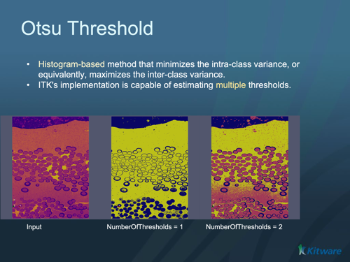

# Otsu Multiple Thresholds Image Filter

Threshold an image using multiple Otsu Thresholds.

## Group (Subgroup)

NXImageProcessing (Thresholding)

## Description

This filter creates a labeled image that separates the input image into various classes. The filter computes the thresholds using a multi-Otsu calculator and applies those thresholds to the input image to produce class labels. The **Number Of Histogram Bins** and **Number Of Thresholds** control the calculator. The **Label Offset** is added to every output label so labels can start from a value other than zero.

Each finite, selected voxel receives the number of thresholds that its intensity strictly exceeds, plus **Label Offset**. A value equal to a threshold belongs to the lower class. The input can use any scalar signed or unsigned integer type, `float32`, or `float64`. The output is always a scalar `uint8` label image with the input tuple shape. Threshold values use the input intensity units; output labels have no intensity units.

The configured class interval is **Label Offset** through **Label Offset + Number Of Thresholds**, including both endpoints. The sum must not exceed 255. The filter rejects an invalid interval instead of wrapping labels. It does not renumber classes or widen the output type.

### NaN and infinity

**Nonfinite Input Handling** has two choices:

- **Error** is the default. A selected NaN, negative infinity, or positive infinity stops the filter. Choose a deliberate handling method before rerunning the pipeline.
- **Warn and Continue** fits thresholds using selected finite pixels. Selected NaN and infinity pixels receive **Excluded Label**. One warning counts the nonfinite pixels still selected after any mask.

Both choices require at least one selected finite sample. Empty data, an all-false mask, or data with no selected finite value cannot define a histogram range and cause an error.

### Explicit mask and excluded labels

Enable **Use Mask Array** to select a **Mask Array**. The mask must be scalar `bool` or `uint8`. Its final tuple count must match the input when Otsu runs, after any upstream filters have resized their arrays. Tuples are paired in flat order, so the mask can have a different tuple shape or parent group. False/zero excludes a pixel; true or any nonzero `uint8` value selects it. The filter applies this selection before range, histogram, and nonfinite checks. An excluded NaN or infinity therefore causes no nonfinite error or warning.

Pixels excluded by the mask and nonfinite pixels skipped in Warn mode use the same **Excluded Label**. It defaults to 255 and must be outside the configured class interval when a mask is enabled or Warn is used with floating-point input. This leaves up to 255 ordinary classes. Choose an unused label or reduce the class interval if the label collides.

A distinct label does not make downstream filters ignore excluded pixels. Supply the mask or an explicit background/exclusion rule to consumers that must ignore them. Changing histogram participation can change phase fractions, feature counts, and connectivity.

For input [0, 0, 4, 4, NaN, negative infinity, positive infinity], Warn uses histogram counts [2, 2] with two bins.
With Label Offset 7 and Excluded Label 255, it writes [7, 7, 8, 8, 255, 255, 255]. A mask that excludes the three
nonfinite pixels gives the same labels with either choice and produces no nonfinite warning.

For component labeling, first select the ordinary class of interest into a binary mask. For fractions measured over valid
pixels, exclude Excluded Label from both the selection and the denominator. Removing nonfinite samples from the histogram
can move the fitted thresholds and change the labels of finite pixels too.

### Precision and pipeline migration

Histogram bounds, bin measurements, and threshold fitting use `float64`. The filter checks for detectable unusable range/bin geometry, nonfinite arithmetic, and objective underflow. For example, distinct adjacent large 64-bit integers can become equal after conversion to `float64`, and very small nonzero class means can square to zero. These conditions cause a numeric error. Rescale the finite data or use fewer bins where suitable. The checks do not establish exact arbitrary-precision Otsu accuracy. True finite constants retain the lower-class tie behavior.

The finite tie tolerance, ordinary threshold search, and Valley Emphasis behavior are retained. **ReturnBinMidpoint** selects a bin midpoint instead of its maximum for the returned threshold. These checks add no automatic normalization or new scientific fitting rule.

Existing pipelines receive Error, Use Mask Array off, and Excluded Label 255 as defaults. Ordinary finite pipelines with valid label intervals and usable histogram and solver arithmetic retain their labels. A finite pipeline that previously completed can now stop with a numeric error if the new checks detect an unusable calculation. Pipelines that previously contained NaN/infinity now stop by default. Choose Warn to skip selected nonfinite pixels and assign Excluded Label. Replacing nonfinite values upstream adds replacement intensities to the histogram and can bias thresholds; it is not statistical exclusion.

This filter also includes an option to use the valley emphasis algorithm from H.F. Ng, "Automatic thresholding for defect detection", Pattern Recognition Letters, (27): 1644-1649, 2006. The valley emphasis algorithm is particularly effective when the object to be thresholded is small. It is turned off by default; enable it with **Valley Emphasis**.

ITK-free, out-of-core-capable reimplementation of the legacy ITK Otsu Multiple Thresholds Image Filter. The histogram and input range are computed with bounded-memory streaming passes, so memory use stays bounded regardless of image size.

## Algorithm

For integral inputs whose selected native intensity span is at most 65,535, the filter can determine the input range and exact value frequencies in one scan using a fixed 65,536-entry frequency ring. It then fills the requested histogram without rereading the input. Wider integral ranges use a second bounded histogram scan. Buffered scans also use a second scan when the working-memory grant cannot hold the ring after reserving the input and any mask buffers. Floating-point inputs use a selected finite range/count scan followed by the histogram scan. A true constant has an analytic tied-threshold path.

The histogram uses the existing marginal upper bound `max + (max - min) / (numberOfBins * 100)`. An upper-bound extension that rounds back to `max` is permitted when the bin geometry remains usable; endpoint clamping keeps minimum/maximum samples inside their bins before an integer index conversion. Native full-span 64-bit inputs remain valid for a two-bin split. No native maximum is incremented.

Thresholds are calculated from the histogram and applied independently to each selected voxel. Resident scans use direct spans. Other scans use serial bulk input/mask transfers with bounded owned buffers and working-memory reservations. Floating-point range scans reduce fixed blocks in parallel when multicore support is enabled and a batch contains more than one block. Workers read only resident spans or owned buffers. The main thread merges finite bounds and selected counts in block order. The summary table belongs to the current bounded batch and does not grow with the full image.

The input, mask, and floating-range summaries share a scratch target of at most 64 MiB; a low grant can reduce a buffered scan to one tuple. The masked output pass reserves combined input, mask, and label buffers. Boolean masks use contiguous owned storage. The optional ring and histogram/solver arrays depend on the fixed ring size and requested bin/class counts, not on image volume. The unmasked output pass retains the existing resident/buffered pointwise routes. No full-volume finite-only copy is made.

Cancellation is checked during scans and threshold search and before label writes. Transfer failures remain errors. Completed earlier label batches are not rolled back if a later output transfer fails.

% Auto generated parameter table will be inserted here

## Example Pipelines

## License & Copyright

Please see the description file distributed with this plugin.

## DREAM3D-NX Help

If you need help, need to file a bug report or want to request a new feature, please head over to the [DREAM3DNX-Issues](https://github.com/BlueQuartzSoftware/DREAM3DNX-Issues/discussions) GitHub site where the community of DREAM3D-NX users can help answer your questions.
