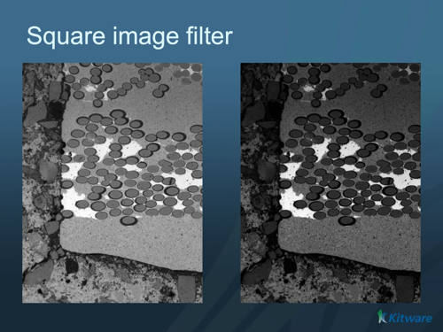

# Square Image Filter

Squares each component of a numeric image.

## Group (Subgroup)

NXImageProcessing (Pointwise)

## Description

Square calculates `x × x` independently for each component and preserves the input tuple and component dimensions. An input measured in metres produces an output in square metres.

### Output types

| Input type | Output type |
|---|---|
| Int8, UInt8 | Int16, UInt16, respectively |
| Int16, UInt16 | Int32, UInt32, respectively |
| Int32, UInt32 | Int64, UInt64, respectively |
| Int64, UInt64 | Same as input |
| Float32, Float64 | Same as input |

Each 8-, 16-, or 32-bit integer input widens to an output that requires twice as many uncompressed bytes per component.

### Integer images

Integer results are exact within the output range. For example, a UInt8 input of 16 gives UInt16 256. A UInt16 input of 4,097 gives UInt32 16,785,409. A UInt32 input of 4,294,967,295 gives UInt64 18,446,744,065,119,617,025.

Int64 inputs must be between −3,037,000,499 and 3,037,000,499 inclusive. UInt64 inputs must be at most 4,294,967,295. At execution, Square scans a 64-bit integer input and reports an out-of-range value before multiplication. If approximate squares are acceptable beyond these limits, use [Convert AttributeArray DataType](../SimplnxCore/ConvertDataFilter.md) to convert the input to Float64 before running Square.

Check downstream type requirements when reopening an older pipeline. For example, the **Write Image** raw PNG path with **Create Color Table** off accepts UInt8. A squared UInt8 image now has UInt16 output. Raw MetaImage (MHA) can preserve the widened integer values.

### Floating-point images

Floating inputs retain their type and round to its precision. Either sign of zero squares to positive zero. NaN gives NaN, and either infinity gives positive infinity. Sufficiently large finite magnitudes can overflow to positive infinity, and small magnitudes can underflow to a subnormal value or positive zero.

## Algorithm

Square uses integer arithmetic for integer images. The preliminary range scan adds one input pass for Int64 and UInt64. Other types use a single pointwise pass. Resident and disk-backed arrays use the same numerical rules.

% Auto generated parameter table will be inserted here

## Example Pipelines

The **Radiography Intensity Calibration** bookmark creates **Squared Transmission** from the transmission image. [Example pipeline guide](https://github.com/BlueQuartzSoftware/simplnx/blob/develop/src/Plugins/NXImageProcessing/pipelines/15_Radiography_Intensity_Calibration/15_Radiography_Intensity_Calibration.md)

## License & Copyright

Please see the description file distributed with this plugin.

## DREAM3D-NX Help

If you need help, need to file a bug report or want to request a new feature, please head over to the [DREAM3DNX-Issues](https://github.com/BlueQuartzSoftware/DREAM3DNX-Issues/discussions) GitHub site where the community of DREAM3D-NX users can help answer your questions.
