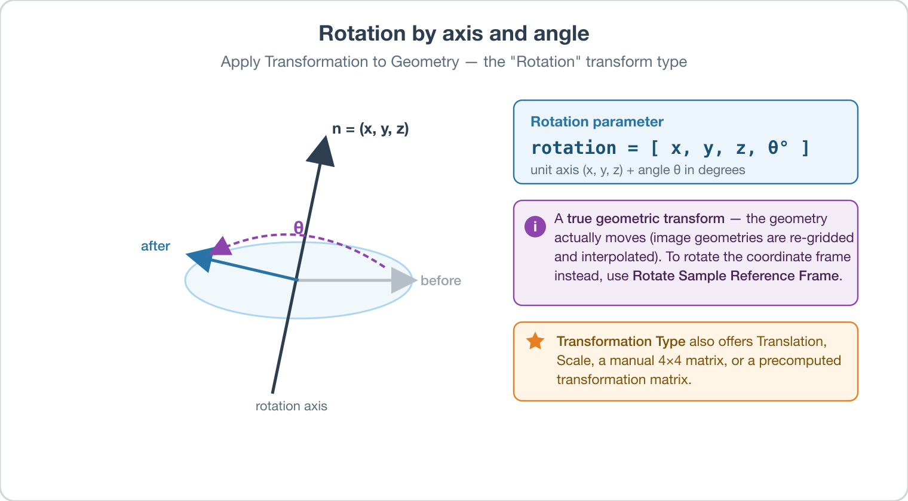
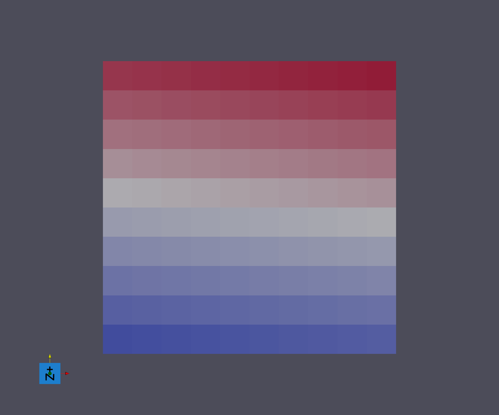
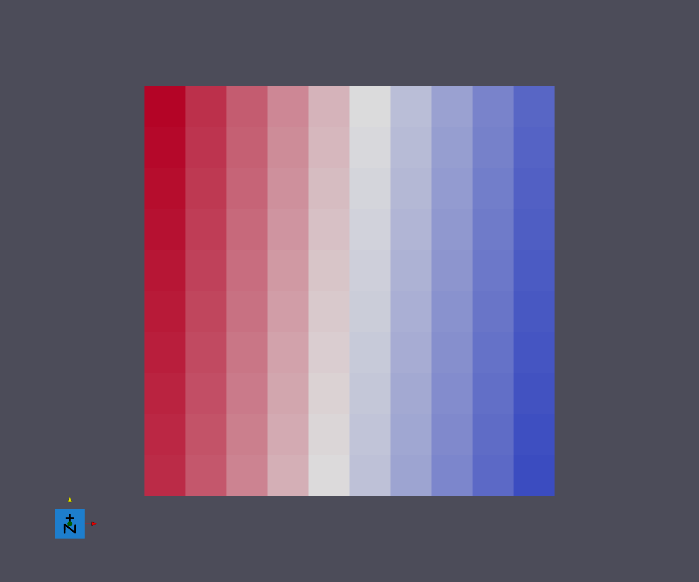
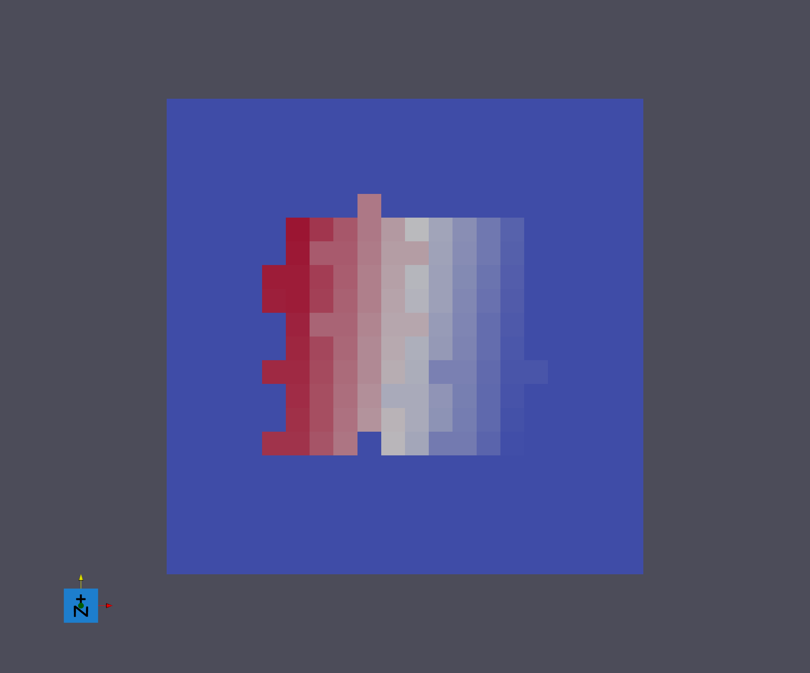
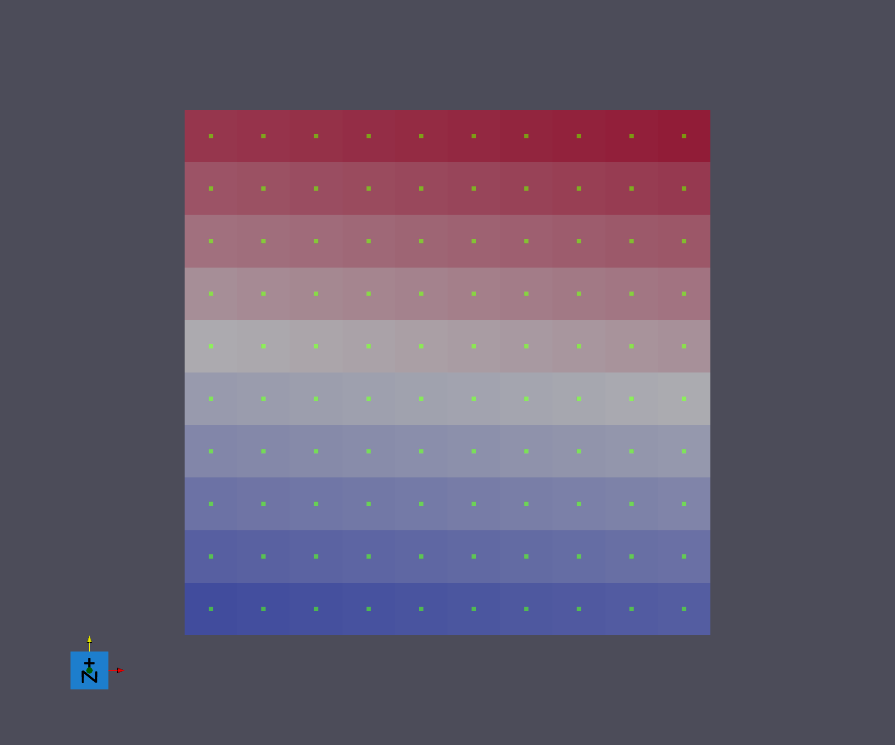
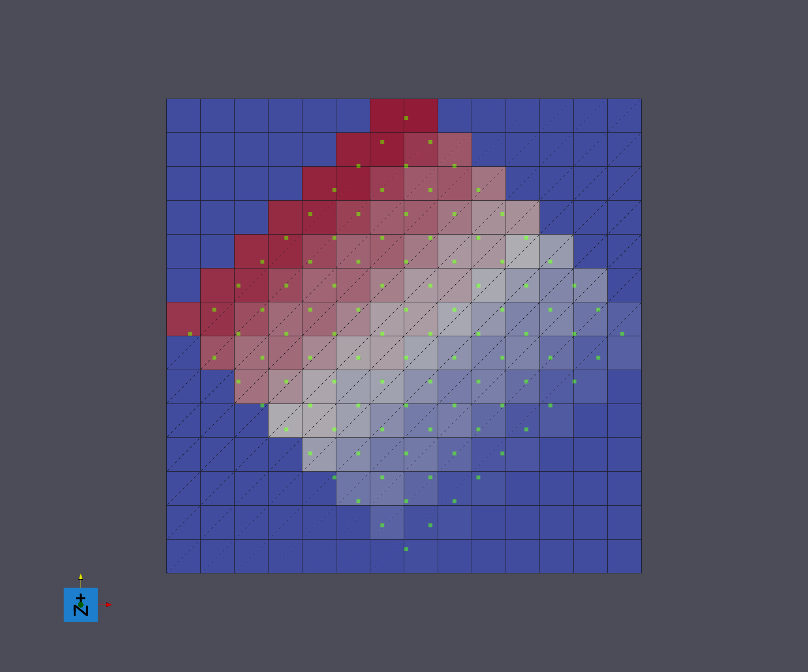
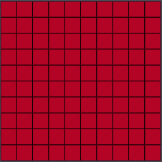
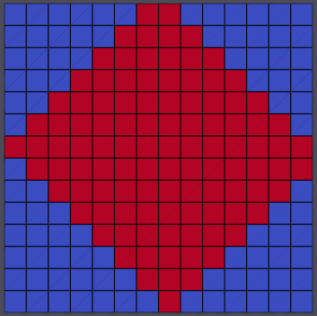
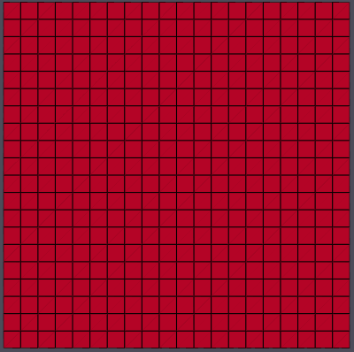

# Apply Transformation to Geometry

## Group (Subgroup)

Rotation, Scale & Transformation

## Description

This **Filter** applies a spatial transformation -- rotation, translation, scaling, or an arbitrary 4x4 matrix -- to a **Geometry**. Both **Image Geometries** and node-based geometries (Vertex, Edge, Triangle, Quadrilateral, Tetrahedral, Hexahedral) are supported.

### Node Geometries

For node-based geometries, the transformation modifies vertex positions only. No interpolation occurs. Multiple transformations can be applied in succession without artifacts.

### Image Geometry

For Image Geometries, transformation requires re-gridding because cell positions are implicit in the grid spacing and origin. After transformation, a new grid is generated and cell data is interpolated onto it. This is governed by two extra parameters:

- **Interpolation Method** -- how cell data values are sampled from the old grid (see below).
- **Cell Attribute Matrix** -- which attribute matrix holds the cell data to transform.

### Image Geometry Caveat: Successive Transformations

Applying multiple transformations one-at-a-time to an Image Geometry produces visible re-gridding artifacts because each intermediate step re-samples the data. The following example shows a 90-degree rotation done as a single step versus as two 45-degree steps:

| Description | Image |
|-------------|----------------------|
| Input Image |   |
| After single 90-degree rotation around <001> |  |
| After first 45-degree rotation |  |
| After second 45-degree rotation (artifacts visible) |  |

The problem is that after the first 45-degree rotation, the cell centers no longer align with the new grid cells -- the re-gridding has shifted them. On the second rotation, those misalignments compound.

| Description | Image |
|-------------|----------------------|
| Input Image |   |
| After 1st 45-degree rotation (cell centers in green) |  |

To avoid these artifacts, **combine all transformations into a single 4x4 matrix first** using [Combine Transformation Matrices](CombineTransformationMatricesFilter.md), then apply that combined matrix as a single transformation:

| Description | Image |
|-------------|----------------------|
| Combined 90-degree rotation applied once |  |

This caveat only applies to Image Geometries. Node-based geometries can have any number of transformations chained without issue.

### Example Transformations (Image Geometry)

| Description | Example Output Image |
|-------------|----------------------|
| Input Image |   |
| 45-degree rotation around <001> |  |
| 2x scale in X and Y |  |

### Transformation Type

The *Transformation Type* parameter selects how the transformation is specified:

| Value | Type | Description |
|---|---|---|
| 0 | No Transform | Identity (geometry unchanged). |
| 1 | Pre-Computed Transformation Matrix (4x4) | A 4x4 matrix supplied as a 16-element float32 Attribute Array in row-major order. |
| 2 | Manual Transformation Matrix | A 4x4 matrix typed in directly. |
| 3 | Rotation | Axis-angle: a unit vector (x, y, z) and an angle in **degrees**. |
| 4 | Translation | A (dx, dy, dz) translation vector in the geometry's physical units. |
| 5 | Scale | A (sx, sy, sz) scaling vector (dimensionless multipliers). |

The linear / bi-linear / tri-linear interpolation math is adapted from [Purdue CS530 slides, page 36](https://www.cs.purdue.edu/homes/cs530/slides/04.DataStructure.pdf).

If *Translate Geometry To Global Origin Before Transformation* is enabled, the geometry is shifted so its centroid sits at (0, 0, 0) before the transformation is applied, then translated back. Use this to rotate about the geometry's center rather than the world origin.

### Interpolation Method (Image Geometry Only)

- **Nearest Neighbor [0]** -- each output cell takes the value of the nearest input cell. Fast; preserves sharp boundaries; blocky.
- **Linear (trilinear in 3D) [1]** -- each output cell value is interpolated from surrounding input cells. Smoother; may blur sharp features.
- **No Interpolation [2]** -- no resampling. Use only when the transformation does not change the grid topology (e.g., integer translations that align exactly with the existing grid).

### Feature Attribute Matrix

A **Feature** is a group of elements (cells, vertices, edges, faces, or polyhedra) with the same Feature Id.
A **Feature Attribute Matrix** stores one row for each Feature Id.

**Clear Feature Attribute Matrix** is on by default. Transformations can make Feature data incorrect.
For example, translation changes centroids. Scaling changes sizes. Image resampling can remove Features.
Recompute any Feature data needed later in the pipeline.

Select the Feature Attribute Matrix that is a direct child of the selected geometry.
Do not select the Cell, Vertex, Edge, Face, or Polyhedron Attribute Matrix that holds element data.

With **Clear Feature Attribute Matrix** on, the filter removes all children of the selected Feature Attribute Matrix.
This includes numeric arrays, String Arrays, and NeighborLists. The empty matrix keeps its original tuple shape.
Image rotation and matrix transformations create this empty matrix in the replacement geometry.
Image translation, image scaling, and node transformations clear the matrix in place.
Other Attribute Matrices, such as Ensemble data, keep their values.
The Clear option also applies when **No Transform** is selected.

**Renumber Features** applies only when Clear is on. The remaining Feature Ids become 1 through N.
The empty Feature Attribute Matrix is resized to N+1 rows. Row 0 is for background (Feature Id 0).
Renumbering does not compute new Feature values.
For an Image Geometry, select Feature Ids in the selected Cell Attribute Matrix so they are resampled.
For a node geometry, select Feature Ids in a Vertex, Edge, Face, or Polyhedron Attribute Matrix of that geometry. Other Attribute Matrices are not accepted.
Use nearest neighbor resampling for Feature Ids. Linear interpolation can mix integer labels.

With Clear off, Feature data keeps its values. A replacement geometry receives a copy of this data.
The Renumber setting is ignored. These Feature values can be incorrect for the transformed geometry.
Pipelines imported from DREAM3D 6.x start with Clear and Renumber off to preserve legacy behavior.
Native pipelines without the Clear parameter use its default value, on.

| Clear Feature Attribute Matrix | Renumber Features | Result |
|---|---|---|
| On | On | Remaining Feature Ids become 1 through N. The empty matrix has N+1 rows, including row 0. |
| On | Off (default) | The empty matrix keeps its original tuple shape. Feature Ids keep their original values. |
| Off | Hidden and ignored | The Feature Attribute Matrix keeps its arrays and values. Feature Ids keep their original values. |

### Saving the Final Transformation Matrix

Optionally, the final 4x4 transformation matrix can be saved as an Attribute Array. The output is a 16-element float32 array in **row-major** order:

    1 2 3 4 5 6 7 8 9 10 11 12 13 14 15 16

represents the 4x4 matrix:

    1   2   3   4
    5   6   7   8
    9   10  11  12
    13  14  15  16

### Required Input Sources

- **Geometry** -- any supported geometry; for Image Geometry workflows, typically produced by [Create Image Geometry](CreateImageGeometryFilter.md), [Read Image Stack](../ImageProcessing/ReadImageStackFilter.md), or an EBSD reader.
- **Pre-Computed Transformation Matrix** (only for Transformation Type 1) -- typically produced by [Combine Transformation Matrices](CombineTransformationMatricesFilter.md).
- **Cell Attribute Matrix** (Image Geometry only) -- the cell-level data to be re-gridded.

% Auto generated parameter table will be inserted here

## Preflight Information and Errors

**Cleared Feature Data** lists the arrays removed from the selected Feature Attribute Matrix.
If Renumber is on, it also states that Feature Ids and the matrix size change.
**Feature Data Not Cleared** warns that retained Feature values can describe the original geometry.

Errors -67451 and -67452 are checked whenever Clear is on, also when Renumber is off.
Errors -67453 and -67454 are checked only when Clear and Renumber are both on.

| Code | Cause | Correction |
|---|---|---|
| -67451 | The Feature Attribute Matrix is not a direct child of the selected geometry. | Select a Feature Attribute Matrix in that geometry. |
| -67452 | The selected Feature Attribute Matrix holds Cell, Vertex, Edge, Face, or Polyhedron data. | Select the matrix that holds Feature data, or turn Clear off. |
| -67453 | Feature Ids are outside the required Attribute Matrix. | For images, select Feature Ids in the selected Cell Attribute Matrix. For nodes, select an array in a Vertex, Edge, Face, or Polyhedron Attribute Matrix of the geometry. |
| -67454 | The Feature Ids tuple count differs from the element count. | Select an array with one tuple per element. |

When Clear and Renumber are both on, the filter checks all source Feature Ids before it transforms the geometry. Negative IDs and IDs outside the source Feature Attribute Matrix are errors.
This check includes source cells that image resampling removes.

## Example Pipelines

- Pipelines/SimplnxCore/ApplyTransformation_Demo.d3dpipeline
- Pipelines/SimplnxCore/ApplyTransformation_Image.d3dpipeline
- Pipelines/SimplnxCore/Surface_Mesh_Examples/ApplyTransformation_Node.d3dpipeline

## License & Copyright

Please see the description file distributed with this plugin.

## DREAM3D-NX Help

If you need help, need to file a bug report or want to request a new feature, please head over to the [DREAM3DNX-Issues](https://github.com/BlueQuartzSoftware/DREAM3DNX-Issues/discussions) GitHub site where the community of DREAM3D-NX users can help answer your questions.
