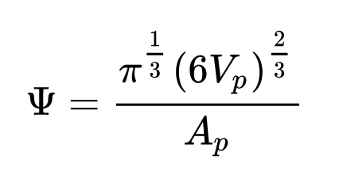

# Compute Surface Area to Volume & Sphericity

## Group (Subgroup)

Statistics (Morphological)

## Description

This **Filter** calculates the ratio of surface area to volume for each **Feature** in an **Image Geometry**. A **Feature** is a connected region of **Cells** that share the same **Feature Id**. Because surface area has units of length squared and volume has units of length cubed, the resulting ratio has units of *1/length* (the reciprocal of the **Image Geometry** spacing units; for example, if the spacing is in micrometers the ratio is in 1/micrometers).

This filter also optionally calculates the [Sphericity](https://en.wikipedia.org/wiki/Sphericity) of each feature. Sphericity is a *dimensionless* (unitless) measure of how closely a **Feature**'s shape approaches that of a perfect sphere.

Use [Compute Surface Features](ComputeSurfaceFeaturesFilter.md) when you need a separate flag that identifies features touching the sample surface.

### Required Input Sources

- **Cell Feature Ids** -- the per-**Cell** **Feature** label array, typically produced by [Segment Features (Scalar)](ScalarSegmentFeaturesFilter.md) or another segmentation filter.
- **Number of Cells** -- the per-feature cell counts, typically produced by [Compute Feature Sizes](ComputeFeatureSizesFilter.md).

The label array must have one tuple per cell in the selected geometry. The array can be stored separately from that geometry. Its tuple count, cell ordering, and feature labels must describe the selected image. Each Feature Id must index a tuple in the selected feature data.

## Algorithm

For each cell with a positive Feature Id, the filter examines its six face-sharing neighbors within the image. A face contributes area to the current feature when the neighbor has a different Feature Id, including Feature Id 0. An interface between two positive features contributes to each feature's area. Faces outside the image are omitted. Feature Id 0 is the background; its output tuple remains zero.

For cell spacing `(dx, dy, dz)`, the area of a face uses the two spacing components perpendicular to its normal:

- X-normal face: `dy * dz`.
- Y-normal face: `dx * dz`.
- Z-normal face: `dx * dy`.

The filter calculates each feature's volume as `V = Number of Cells * dx * dy * dz`. It uses the supplied cell count without recounting the labels or checking that the count matches them. The surface-area-to-volume ratio is `S / V`, where `S` is the accumulated face area. Area has units of length squared, and volume has units of length cubed.

When *Calculate Sphericity* is enabled, the filter also calculates `Psi = pi^(1/3) * (6 * V)^(2/3) / S`. Psi is dimensionless. For a complete closed surface and consistent positive volume, a sphere has sphericity 1. Both output arrays use 32-bit floating-point values; face areas, accumulated areas, and metric calculations use 64-bit floating-point values.

### Algorithm selection

The filter automatically uses *Direct* when Cell Feature Ids are stored in memory and *Scanline* when they use out-of-core storage. Both methods use the same face-counting and volume rules.

### Direct

Direct reads neighboring labels from the array and accumulates one surface area per feature. Its additional working memory scales as `O(F)`, where `F` is the number of feature tuples, including background.

### Scanline

Scanline reads labels in sequential slices and keeps three adjacent XY slices in memory. It reads the feature counts and writes the metrics in bulk. Its additional working memory scales as `O(X * Y + F)`, where `X` and `Y` are image dimensions in cells. This avoids buffering the full label volume, but the feature arrays can still be large when the feature count approaches the cell count. These memory estimates exclude the input/output stores and their caches.

### Compatibility with earlier results

Corrected X/Y face weights can change results when X and Y spacings differ. That weight correction alone leaves isotropic face products unchanged. The improved numerical precision and sphericity calculation can also change isotropic results.

### WARNING - Aliasing

The surface area will be the surface area of the **Cells** in contact with the neighboring **Feature** and will be influenced by the *aliasing* of the structure — the jagged, stair-stepped approximation of a smooth surface that results from representing it on a discrete voxel grid. As a result, the surface area to volume will likely be over-estimated with respect to the *real* **Feature**.

### WARNING - Incomplete surfaces and nonfinite results

Image-exterior faces are omitted, so a feature touching the image boundary can have an incomplete measured surface. This can reduce its surface-area-to-volume ratio and increase its sphericity, even above 1. In-image faces against Feature Id 0 are included.

The filter does not reject zero or negative supplied cell counts or replace nonfinite results. For positive area and zero volume, the ratio is infinite and sphericity is zero. For positive volume and zero measured area, the ratio is zero and sphericity is infinite. Zero area with zero volume produces NaN (not a number). A negative volume can produce a negative ratio and NaN sphericity. Interpret these values as limitations of the supplied volume or measured surface.

### Warning - 2D Image Geometry Results

For a single XY slice, each cell still has thickness `dz`, and the filter uses three-dimensional cell volumes. Both Z-normal faces lie outside the image and are omitted. The counted side-face area equals the counted in-plane boundary length times `dz`.

When the supplied counts match the labels, thickness cancels in the ratio. The result then equals counted in-plane boundary length divided by feature area, with units of inverse length. Image-exterior edges remain omitted, so this need not be the feature's full perimeter-to-area ratio. Optional sphericity still uses the three-dimensional formula and depends on the slice thickness; it is not a two-dimensional circularity measure.

% Auto generated parameter table will be inserted here

## Example Pipelines

+ (03) Small IN100 Morphological Statistics

## License & Copyright

Please see the description file distributed with this **Plugin**

## DREAM3D-NX Help

If you need help, need to file a bug report or want to request a new feature, please head over to the [DREAM3DNX-Issues](https://github.com/BlueQuartzSoftware/DREAM3DNX-Issues/discussions) GitHub site where the community of DREAM3D-NX users can help answer your questions.
