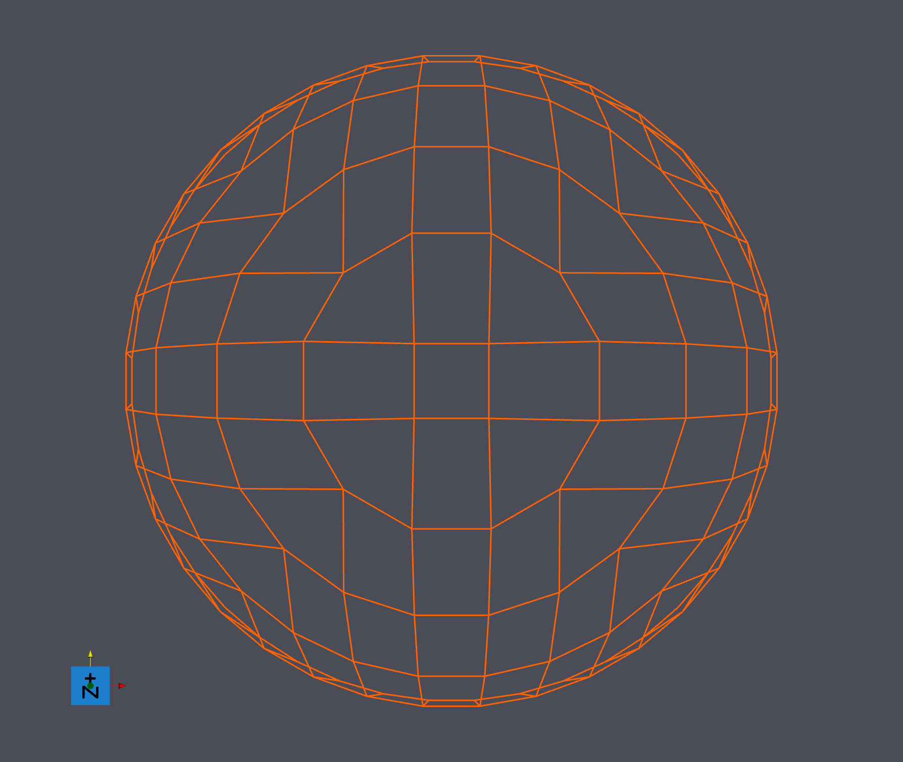
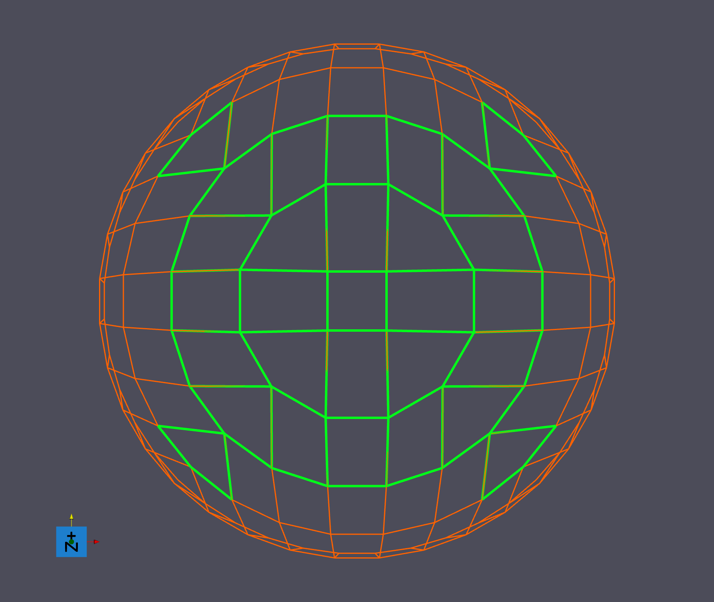
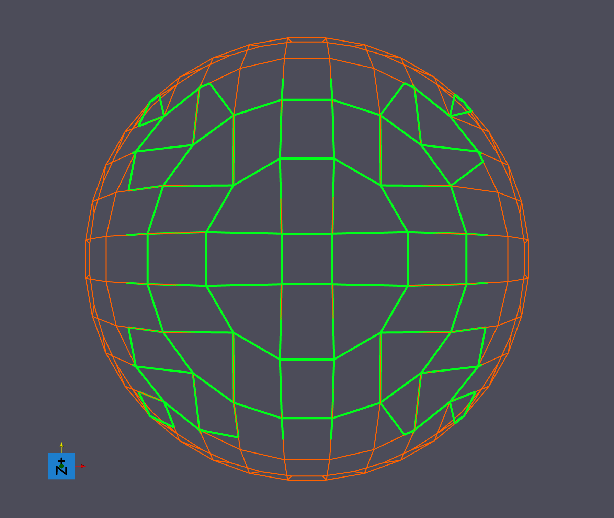
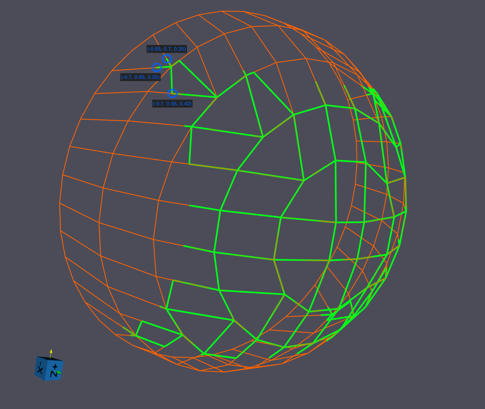

# Crop Geometry (Edge)

## Group (Subgroup)

Core (Conversion)

## Description

The **Crop Geometry (Edge) Filter** allows users to crop a region of interest (ROI) from an **Edge Geometry**. This filter is essential for isolating specific portions of edge-based data structures. For cropping voxel-based data instead, see [Crop Geometry (Image)](CropImageGeometryFilter.md).

Copied child objects retain their names, including Attribute Matrix and DataArray names that contain the source geometry's name. For example, copying `Geom/Geom Feature Data/Geom Values` to `Geom Out` creates `Geom Out/Geom Feature Data/Geom Values`. The output uses the complete destination path, including its parent DataGroup.

Users can selectively crop specific dimensions of the **Edge Geometry** by toggling **Crop X Dimension**, **Crop Y Dimension**, and **Crop Z Dimension** ON or OFF. Only dimensions that are turned ON will be cropped.

A vertex inside the crop bounds that no kept edge uses is not copied to the created **Edge Geometry**.

The **Min Coordinate** and **Max Coordinate** values define the ROI bounds and are specified in the **Edge Geometry's** physical coordinate units (the same units as the vertex positions), *not* as cell or vertex indices.

### Boundary Intersection Behavior

The *Boundary Intersection Behavior* parameter provides the following choices:

- **Interpolate Outside Vertex [0]**: Interpolates the position of vertices that lie outside the ROI, allowing partial edges to be included based on interpolation.
- **Ignore Edge [1]**: Excludes edges that intersect the cropping boundary without throwing an error or interpolating vertices.
- **Filter Error [2]**: Throws an error if any edge intersects the cropping boundary, ensuring strict adherence to the ROI.

**NOTE:** When the **Interpolate Outside Vertex** boundary intersection behavior is chosen, this filter DOES NOT interpolate any vertex data, only the vertex position!

Edge data of clipped edges, such as edge lengths, also keeps its old values. Recompute values that depend on the clipped geometry.

When one vertex outside the crop bounds is shared by edges that cross the bounds at different points, the vertex is duplicated, one copy per crossing. Vertex DataArray values are copied from the source vertex to each duplicate.

StringArray and NeighborList data in the Vertex and Edge Attribute Matrices are copied with the kept vertices and edges.

## Feature Attribute Matrix

A **Feature** is a group of edges with the same Feature Id. A **Feature Attribute Matrix** stores one row of values for each Feature Id. Cropping changes which edges belong to each feature. Features cut by the crop boundary can change size, shape, centroid, neighbors, surface status, and average values. Nothing marks which rows were affected. Treat every value computed before the crop as invalid for the cropped geometry.

Renumbering alone does not correct these values. It changes Feature Ids. It does not recompute feature values.

*Clear Feature Attribute Matrix* is on by default. It recreates the selected matrix in the cropped geometry with no arrays. This removes numeric arrays, string arrays, and **NeighborLists** (lists of neighboring features). Recompute any arrays needed by later filters. A later filter that selects a cleared array fails preflight until that array is created again.

### Clearing and Renumbering Modes

| Clear Feature Attribute Matrix | Renumber Features | Result |
|---|---|---|
| On | On | Dense matrix with no arrays. Remaining feature IDs become 1 through N, where N is the number of remaining features. The matrix has N+1 rows, including row 0. |
| On | Off (default) | Sparse matrix with no arrays. It keeps the source tuple shape and original Feature Ids. Rows for removed features are unused. Use this mode to track features between the original and cropped geometries. |
| Off | Hidden and ignored | All Attribute Matrices other than the Edge and Vertex Attribute Matrices are copied unchanged. Feature Ids are unchanged. Use this mode for raw data without features, or for debugging. Copied feature values still describe the original geometry. |

*Feature Attribute Matrix*, *Renumber Features*, and *Edge Feature Ids* are shown only when *Clear Feature Attribute Matrix* is on. *Renumber Features* is off by default. Both selection paths are required when Clear is on, even when Renumber is off. Select an `int32` array with one component for *Edge Feature Ids*. When Clear and Renumber are both on, *Edge Feature Ids* must be in the selected Edge Geometry's Edge Attribute Matrix. When Clear is off, the filter ignores both selections and any saved Renumber setting.

Other Attribute Matrices, including the **Ensemble Attribute Matrix** (data for each phase), are copied unchanged in every mode.

### Keep the Original Values for Debugging

Turn *Perform In Place* off and set *Created Edge Geometry* to a new path. The source geometry keeps its original feature values. The new geometry contains the cropped edges and follows the selected clearing mode. When *Perform In Place* is on, the cropped geometry replaces the source and keeps its name.

### Preflight Information and Errors

The preflight value **Cleared Feature Data** lists the full paths of the arrays that will be cleared. Use this list to decide what to recompute after Crop. Recompute neighbor lists if later filters need them. When Clear is off, **Feature Data Not Cleared** explains that copied feature values describe the uncropped geometry. These values are information, not warnings.

When Clear is on, the selected Feature Attribute Matrix must be a direct child of *Selected Edge Geometry*. It must not be the geometry's Edge or Vertex Attribute Matrix.

- **-67411**: The Feature Attribute Matrix is not a direct child of the selected geometry. Select an Attribute Matrix that is a direct child of the geometry, or turn off 'Clear Feature Attribute Matrix'.
- **-67412**: The selected matrix is the geometry's Edge or Vertex Attribute Matrix. Select the matrix that holds feature data, or turn Clear off.
- **-67413**: With Renumber on, Edge Feature Ids must be in the selected geometry's Edge Attribute Matrix. Select the array from that matrix.
- **-67414**: With Renumber on, Edge Feature Ids must have one tuple per edge. Select an array with the same tuple count as the edge count.

## Examples
In the following examples, an edge geometry with bounds (-1, 1), (-1, 1), (0, 1) is being used:

### Filter Error Example

| **Parameter**                      | **Value**             |
|------------------------------------|-----------------------|
| **Crop X Dimension**               | ON                    |
| **Crop Y Dimension**               | OFF                   |
| **Crop Z Dimension**               | OFF                   |
| **Min Coordinate**                 | (-1, 0, 0)            |
| **Max Coordinate**                 | (0.2, 0, 0)           |
| **Boundary Intersection Behavior** | Filter Error          |

Since **Crop X Dimension** is the only one turned on, only the X dimension will be cropped.  This means that the filter will only use the X min/max coordinate values to crop the edge geometry; the Y & Z min/max coordinate values will be ignored.

These inputs result in a filter execution error because an edge exists in the edge geometry with the following two vertices:

(0.071339, -0.997452, 0.0)  <--- Inside the X bounds of (-1, 0.2)
(0.212565, -0.977147, 0.0)  <--- Outside the X bounds of (-1, 0.2)

### Ignore Edges Example

| **Parameter**                      | **Value**             |
|------------------------------------|-----------------------|
| **Crop X Dimension**               | ON                    |
| **Crop Y Dimension**               | ON                    |
| **Crop Z Dimension**               | OFF                   |
| **Min Coordinate**                 | (-0.7, -0.7, 0)       |
| **Max Coordinate**                 | (0.7, 0.7, 0)         |
| **Boundary Intersection Behavior** | Ignore Edge           |

Since **Crop X Dimension** and **Crop Y Dimension** are turned on, only the X & Y dimensions will be cropped.  This means that the filter will only use the X & Y min/max coordinate values to crop the edge geometry; the Z min/max coordinate values will be ignored.

These inputs result in the following edge geometry output:

The original edge geometry is orange, the cropped edge geometry (which overlaps the orange) is in green.

As you can see, any edges that contain vertices that are outside (-0.7, 0.7) in the X dimension and (-0.7, 0.7) in the Y dimension have been cropped out.

### Interpolate Outside Vertices Example

| **Parameter**                      | **Value**                  |
|------------------------------------|----------------------------|
| **Crop X Dimension**               | ON                         |
| **Crop Y Dimension**               | ON                         |
| **Crop Z Dimension**               | OFF                        |
| **Min Coordinate**                 | (-0.7, -0.7, 0)            |
| **Max Coordinate**                 | (0.7, 0.7, 0)              |
| **Boundary Intersection Behavior** | Interpolate Outside Vertex |

Let's take the same example as the previous, but instead set the **Boundary Intersection Behavior** to interpolate outside vertices.

Again, since **Crop X Dimension** and **Crop Y Dimension** are turned on, only the X & Y dimensions will be cropped.  This means that the filter will only use the X & Y min/max coordinate values to crop the edge geometry; the Z min/max coordinate values will be ignored.

Unlike the last example, however, this time the filter will interpolate any outside vertices of edges that are intersecting the ROI boundary so that those edges can still be included in the final edge geometry:

The original edge geometry is orange, the cropped edge geometry (which overlaps the orange) is in green.

Three outside vertices, that have been interpolated to lie within the boundary, are circled in blue.

As you can see, the edges that intersect the ROI boundary have been interpolated so that the outside vertex lies exactly on the boundary edge.  Edges that have both vertices outside the boundary are cropped out completely.

% Auto generated parameter table will be inserted here

## License & Copyright

Please see the description file distributed with this **Plugin**

## DREAM3D-NX Help

If you need help, need to file a bug report or want to request a new feature, please head over to the [DREAM3DNX-Issues](https://github.com/BlueQuartzSoftware/DREAM3DNX-Issues/discussions) GitHub site where the community of DREAM3D-NX users can help answer your questions.
